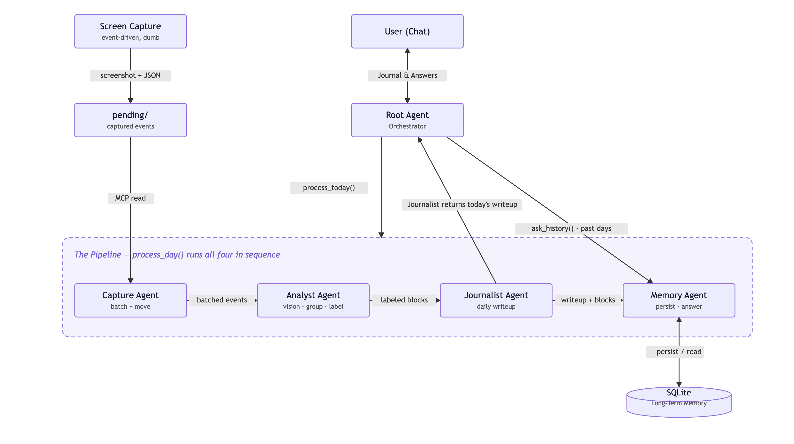

# Contextline

A local work-journal that turns raw screen activity into a semantic daily timeline.

When you spend all day at a computer, the hours blur together and it is hard to remember what you
actually worked on. Contextline watches your screen activity and reconstructs your day as
readable activities, so you can look back, understand your habits, and plan a better tomorrow.

Instead of "Cursor: 3h, Chrome: 1h", the output looks like:

- 09:15–10:00 — Debugging auth flow in Cursor
- 10:00–10:20 — Research on JWT rotation (Chrome, MDN + Stack Overflow)
- 10:20–11:30 — PR review in GitHub

Capture is **event-driven**: a new event fires when the active window or app changes, not on a
fixed clock. It runs entirely on your machine, stores everything locally, and exposes a small HTTP
API. You talk to it through a chat interface, asking about the current day, past days, or how you
want activity grouped.

## Status

**Complete and running.** The full pipeline works end to end against real Vertex AI
(Gemini 2.5 Flash), scores **5/5 on `eval.py`**, and serves over HTTP. Test suite: **48 passed,
6 skipped** (the skips are opt-in live-model tests plus one MCP case that needs `npx`).

All ten build steps from [`CLAUDE.md`](./CLAUDE.md) are implemented, including the real macOS
capture script. See [Real screen capture](#real-screen-capture-macos) for the consent note, and
[`PROGRESS.md`](./PROGRESS.md) for the detailed per-step handoff.

## How it works



Contextline has two layers, kept strictly separate.

**The capture layer is deliberately simple.** It records what is on screen and nothing more. On
every active-window change, [`real_capture.py`](contextline/capture_script/real_capture.py) writes a
capture event: a screenshot plus a small JSON file with the app name, window title, and timestamp.
That is the entire layer — an event source that the agents read from.

**The agent layer does all the thinking**, built on Google ADK as a hierarchy of five agents that
a Root Agent coordinates:

```
pending/ → Capture Agent   (read + batch events, move to processed/, via an MCP filesystem tool)
         → Analyst Agent    (vision: group events and label them into semantic blocks)
         → Journalist Agent (turn the blocks into a readable daily writeup)
         → Memory Agent      (save each day to SQLite, answer questions about past days)
         → Root Agent        (the chat you talk to; holds per-session preferences)
```

Three design decisions are worth calling out (the full list is in `CLAUDE.md` and `PROGRESS.md`):

- **Nothing is hallucinated, by construction.** The Analyst model only groups events and labels
  them. Every hard fact (times, durations, app names, source event IDs) is computed in code from
  the real events, so every block can be traced back to activity that was actually captured.
- **Reruns are free.** An on-disk cache stores each model call keyed on its exact input. The first
  run costs money; every rerun on the same data is served from disk. This is what makes iterating
  on the pipeline and the eval affordable.
- **Conversational preferences stay conversational.** Refinements like "don't count Slack as focus
  time" live in ADK session state and are threaded into later prompts for that chat only. They
  never touch the database.

## Stack

Python 3.11+ · Google ADK · Gemini via Vertex AI (ADC, no API keys) · SQLite ·
MCP filesystem server (with a plain-tool fallback) · pytest

## Run it yourself

This walks through capturing your own real screen activity and turning it into a journal you can
chat with. You need macOS, Python 3.11+, and a Google Cloud project with Vertex AI enabled.

### 1. Get the code

```bash
git clone https://github.com/aseemez/contextline.git
cd contextline
```

Open the folder in VS Code (or your editor) so you can read the agents in `contextline/agents/`
while the system runs.

### 2. Create a virtual environment and install

```bash
python3 -m venv .venv
source .venv/bin/activate
pip install -e ".[capture,dev]"
```

This installs the agent pipeline, the real-capture dependencies (`mss` + `pyobjc`, macOS-only), and
the test tools. It also puts the `adk` command on your PATH, which you'll use in step 6.

### 3. Connect it to Vertex AI

Model calls go through Vertex AI with Application Default Credentials, so there are no API keys
anywhere. Do this once:

```bash
gcloud auth application-default login
gcloud config set project YOUR_PROJECT_ID

cp .env.example .env      # then edit GOOGLE_CLOUD_PROJECT; keep GOOGLE_CLOUD_LOCATION=global
```

`.env` only holds Vertex routing (`GOOGLE_GENAI_USE_VERTEXAI=TRUE`, `GOOGLE_CLOUD_PROJECT`,
`GOOGLE_CLOUD_LOCATION=global`).

### 4. Let macOS see your screen

Real capture reads the frontmost window and takes screenshots, so grant your terminal (or VS Code)
**Screen Recording** permission under System Settings → Privacy & Security → Screen Recording, then
restart it. Without this, capture still runs but window titles come back empty.

### 5. Capture a real work session

Each context switch writes a downscaled screenshot plus a JSON sidecar into `~/.contextline/pending/`.

```bash
# Safe first run — prints each app/window switch, writes nothing:
python -m contextline.capture_script.real_capture --dry-run

# Capture for 15 minutes, then stop on its own:
python -m contextline.capture_script.real_capture --minutes 15

# Or capture until you press Ctrl-C:
python -m contextline.capture_script.real_capture
```

Work normally across a couple of apps for a few minutes so there's something to summarize. Tip: use
separate full-screen windows and Cmd-Tab between them — in split screen, both apps' time is
attributed to whichever one is focused.

### 6. Build the journal and query it from the terminal

Talk to the whole system right in your terminal with `adk run`, pointing it at the agent:

```bash
adk run adk_web/contextline_agent      # run from the repo root; starts an interactive chat
```

Then just type to it, one line at a time:

- **`process today`** — runs the pipeline over what you captured and writes today's journal
- **`what did I do today?`** — shows the timeline back to you
- **`how much time did I spend in Cursor?`** — asks about the day you just built
- **`don't count Slack as focus time`** — a refinement it honors for the rest of the chat

You can also fire a single question without entering the chat:

```bash
adk run adk_web/contextline_agent "process today"
adk run adk_web/contextline_agent "what did I work on this morning?"
```

### 7. Or use the browser dev UI

Prefer a graphical chat? The same agent runs in ADK's web UI:

```bash
adk web adk_web            # run from the repo root, then open the URL it prints
```

Pick **contextline_agent** in the sidebar and use the same prompts as above.

## Tests and evaluation

```bash
python eval.py            # scores the 5 criteria against a fixed fixture (free after the first run)
pytest                    # 48 passed, 6 skipped — hermetic, no API calls
RUN_LLM_TESTS=1 pytest    # include the live-model tests (first run costs)
```
